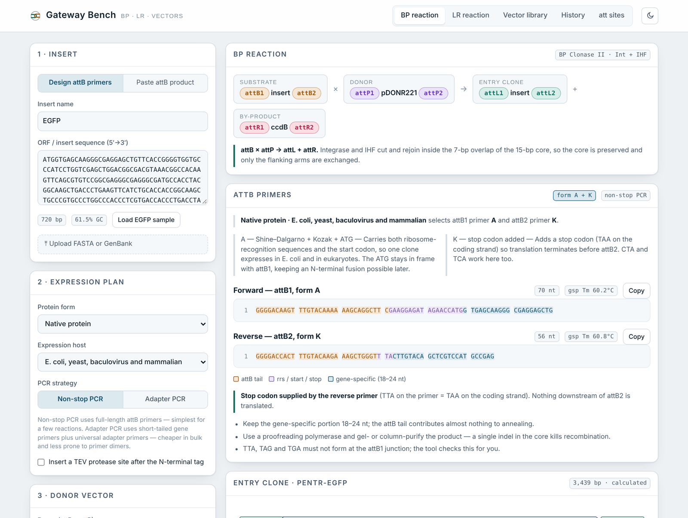

# Gateway Bench

An offline, single-file workbench for Gateway® cloning: simulate BP and LR reactions on real
plasmid sequences, design attB primers from a published protocol, check fusion reading frames,
and export GenBank files you can open in SnapGene.

**[→ Open the app](https://linjianglao.github.io/gateway-cloning/)** · no install, no server, works offline



---

## What it does

**BP and LR reactions on real sequences.** Load a vector's GenBank file and the reaction returns the
complete recombined plasmid — not a size estimate. Backbone features are carried across with shifted
coordinates, the ccdB cassette is removed, and the new att sites and insert are annotated. Without a
vector sequence it still builds the cassette and calculates the plasmid size from the published
vector length.

**attB primer design** following Won Do Heo's protocol (see [Credits](#credits)). Choose the protein
form (native, N-terminal fusion, C-terminal fusion, or native + N-terminal) and the expression host,
and the tool applies the protocol's selection table to pick the attB1 form (**A**, **B** or **C**)
and attB2 form (**K** or **L**), then builds the primer with the right Shine–Dalgarno sequence,
Kozak sequence, start codon, stop codon or frame-completing base. Both the non-stop and adapter PCR
strategies are supported, with the universal adapter primers for the second round. TEV site optional.

**Reading-frame checking** that understands the protocol's geometry. For a C-terminal fusion, form L
deliberately leaves attB2 offset by one base so that the added base completes a CAC codon running
into the tag — the tool verifies that offset rather than flagging it as an error, and tells you to
rebuild with form L when the frame is actually wrong.

**A vector library** of 54 donor, entry and destination vectors — pDONR and pENTR series, the pDEST
*E. coli* set, pcDNA/pEF/pT-REx mammalian vectors, the lentiviral panel (pLX304, pLX301, pLX307,
pLenti CMV Puro DEST, pInducer20/21, pLIX_403), retro/adeno/baculoviral, Y2H and Advanced Gateway
yeast, and plant binaries — extensible with your own plasmids.

**File import and export.** FASTA, GenBank and plain sequence in; GenBank, FASTA and a primer CSV out.

**Sequence viewer** with position numbering and att sites, ribosome-recognition sequences and insert
colour-coded, plus linear and circular plasmid maps.

---

## Adding your own vectors

The app can't call Addgene's API (browser pages like this are blocked from outbound requests), so
plasmids come in as files — which gives you more than a lookup would:

1. Open the plasmid's page on Addgene → **Sequences** → **Download full sequence** (GenBank).
2. In the app, go to **Vector library** → **+ Add vector** and drop the file in.

The app reads the plasmid itself: it locates both att cores, classifies each site as attB / attL /
attR / attP from the five bases flanking the core, infers whether the plasmid is a donor, entry or
destination vector from that pair, detects the ccdB cassette, and pulls the resistance marker and
promoter from the feature labels. Added vectors are usable in reactions immediately.

SnapGene `.dna` files are binary — export as GenBank first.

---

## How the recombination works

Gateway specificity lives in a 15-bp core with a 7-bp strand-exchange overlap at its centre. Each att
site is that core plus flanking sequence, and which site you have is decided by what sits on either
side of the core:

| left of core | right of core | site |
|---|---|---|
| `ACAAG` | `AGGCT` | attB1 |
| λ arm | `AGGCT` | attL1 |
| `ACAAG` | λ arm | attR1 |
| λ arm | λ arm | attP1 |

(and the mirror image for the att2 sites). Recombination is then one operation for both BP and LR:
keep everything outside the two cores, and splice the new insert between them. Whether the product
carries attL sites or attB sites falls out of what the input vector contributed — a donor's λ arms
give attL, a destination's `ACAAG`/`GTGGT` give attB — so the same function handles both reactions
correctly. Circular plasmids whose cassette wraps the origin are rotated first.

---

## Running it

Download [`index.html`](index.html) and open it in any browser. That's the whole app — no server, no
build step, no network. Or use the [hosted copy](https://linjianglao.github.io/gateway-cloning/).

### Building from source

The app is written as modules and assembled into the single file:

```bash
git clone https://github.com/linjianglao/gateway-cloning.git
cd gateway-cloning
python3 build.py
```

| file | contents |
|---|---|
| `src/main-head.html` | markup, design tokens and stylesheet |
| `src/core.js` | att sequences, sequence utilities, map drawing |
| `src/vectors.js` | the vector catalogue |
| `src/lib.js` | FASTA and GenBank parsers/writers, ZIP writer |
| `src/lib2.js` | att-site detection, recombination engine, primer design |
| `src/app.js` | state, views and event wiring |

`build.py` writes `index.html` (standalone) and `dist/artifact.html` (a body-only build for
claude.ai Artifacts, where the host supplies the document shell).

---

## Accuracy and limits

- **Junction sequences, primers and frame logic are exact.** The attB, attL and attR sequences are
  the published ones, and recombination preserves the core base for base.
- **Plasmid sizes without a loaded sequence are calculated**, as the published vector length minus
  its att–ccdB cassette plus the new cassette. Load the GenBank file for an exact product.
- **attP1/attP2 are not reproduced in full** — they carry ~200 bp of λ arms on both sides. Upload
  your donor's GenBank file and the app reads them directly.
- **Backbone features on calculated products are schematic.** Promoter, marker and origin positions
  on the circular map come from the vector class, not from a sequenced map.
- Always sequence across both junctions before using a clone.

---

## Credits

The attB primer design follows **"Primer Design for the Gateway attB primers"**, modified by
**Won Do Heo** — the A/B/C and K/L primer forms, the host × protein-form selection table, the
non-stop and adapter PCR strategies, the TEV fusion primer, and the SeqL-A / SeqL-B sequencing
primers all come from that protocol. The protocol document itself is not redistributed here.

Gateway® is a registered trademark of Thermo Fisher Scientific. This is an independent tool and is
not affiliated with, endorsed by, or derived from any Thermo Fisher software.

Built by [Linjiang Lao](https://github.com/linjianglao).

## License

[MIT](LICENSE)
